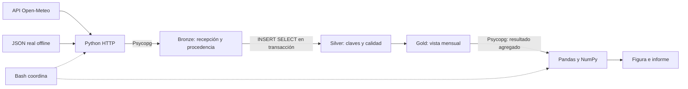

# Observatorio meteorológico · Pandas, PostgreSQL y automatización

Módulo para quinto semestre de Física, Universidad del Quindío. Analizamos un archivo científico, conservamos registros en PostgreSQL y automatizamos actualizaciones con Python/Psycopg y Bash. Datos reales **ERA5 vía Open-Meteo**, no mediciones de instrumentos locales.

## Tres clases, 270 minutos

| Clase | Contenido | Tiempo |
|---|---|---|
| 1 | Fuentes, DataFrame/Series, índices, selección, vectorización, ausencias, grupos y Matplotlib | 90 min |
| 2 | merge/transform, pivot/pivot_table/melt/concat, trazabilidad; después motores, OLTP/OLAP, tablas, claves y primeras consultas | 45 + 45 min |
| 3 | Agregaciones, relaciones, integridad, transacciones, CTE, vista, actualización, Bash y Psycopg | 90 min |

`01_clases_magistrales.ipynb` desarrolla explicación, código, resultados esperados e interpretación. Su sección 4 ofrece seis escenarios de memoria, red y escalabilidad como **lectura complementaria**, no tiempo magistral adicional. `02_practica_sin_nota.ipynb` conserva una progresión autónoma sin soluciones. Instalación fuera de clase; no se añaden requisitos al trabajo final.

## Datos y arquitectura

Tres ubicaciones verificadas: Armenia (Quindío), Bogotá y Barranquilla. Variables: ciudad, fecha, máxima y mínima diaria (°C) y precipitación diaria (mm). Periodo cerrado: enero–febrero de 2024, zona America/Bogota. [Procedencia, licencia, coordenadas y límites científicos](datos/README.md).



Todo el procesamiento central ocurre en una instancia local PostgreSQL y un proceso Python en Ubuntu WSL2. Bronze conserva primera recepción, URL, hash y momento de carga; Silver exige clave ciudad–fecha, integridad referencial, mínimos coherentes y precipitación no negativa; Gold calcula medias y cobertura sobre **días del calendario**, publicando acumulado de precipitación solo con cobertura del 100%.

Esta es una aproximación didáctica Bronze–Silver–Gold. No archiva revisiones completas ni implementa servicios industriales. PostgreSQL aporta persistencia, reglas y consultas compartidas; Pandas analiza resultados y Bash controla la secuencia.

## Ejecutar

Prepara WSL2/Ubuntu, VS Code, rol peer, base propia y entorno virtual con [GUIA_POSTGRESQL.md](GUIA_POSTGRESQL.md). Desde la raíz del repositorio, en Bash Ubuntu:

```bash
cd notebooks/cierre_pandas_sql_2026
python3 -m venv .venv
source .venv/bin/activate
python -m pip install -r ampliacion/requirements.txt
export PGDATABASE=curso_datos
bash ampliacion/pipeline.sh offline inicial
bash ampliacion/pipeline.sh offline actualizacion
bash ampliacion/pipeline.sh offline actualizacion
```

Dependencias instaladas y servicio activo son requisitos previos incluso offline. En una base nueva:

| Paso | Recibidas | Nuevas | Silver/Bronze | Gold |
|---|---:|---:|---:|---:|
| Inicial: 1–31 enero | 93 | 93 | 93 | 3 |
| Actualización: 25 enero–29 febrero | 108 | 87 | 180 | 6 |
| Repetición actualización | 108 | 0 | 180 | 6 |

DO NOTHING evita duplicar, **no corrige** registros existentes. Repetir inicial después de actualizar conserva los 180 registros. La vista refleja las tablas al volver a consultarse. Para la misma carga desde internet cambia `offline` por `online`; no hace falta esperar datos nuevos. La copia congelada da reproducibilidad incluso si el servicio falla o revisa los datos.

Cada corrida genera `salidas_pipeline/ejecucion.XXXXXX/` con log de carga, consulta, CSV final, procedencia, informe y figura `temperatura_mensual.png`; `COMPLETADO.txt` solo aparece tras finalizar. El CSV es un producto final: no se usa como intermediario obligatorio entre API, PostgreSQL y Pandas. Si falla una etapa posterior a la carga, los datos confirmados permanecen y se puede repetir sin duplicados.

Para consultas y exportación opcional:

```bash
psql -X -v ON_ERROR_STOP=1 -f sql/01_consultas_clase.sql
python ampliacion/consulta_local.py
bash ampliacion/ejecutar_resumen.sh
```

## Archivos

| Archivo o carpeta | Función |
|---|---|
| `01_clases_magistrales.ipynb` | Tres clases completas y escenarios A–F |
| `02_practica_sin_nota.ipynb` | P1–P6 y S1–S8 sin soluciones |
| `GUIA_POSTGRESQL.md` | Instalación, autenticación, ejecución y problemas frecuentes |
| `datos/originales/`, `datos/procedencia.json` | Seis respuestas API reales y manifiesto con SHA-256 |
| `datos/meteorologia.csv` | 180 filas para Pandas, derivadas de las respuestas |
| `sql/00_crear_y_cargar.sql` | Esquemas, tablas, catálogo y vista; Python carga datos |
| `sql/01_consultas_clase.sql`, `sql/02_practica.sql` | Demostraciones y enunciados SQL |
| `sql/resumen_mensual.sql` | Consulta Gold usada por el informe |
| `ampliacion/01_preparar.py`, `02_resumir.sql` | HTTP/offline, ingesta y promoción atómica |
| `ampliacion/03_informar.py` | Recuperación directa y análisis de Gold |
| `ampliacion/pipeline.sh` | Secuencia completa; nombre de carpeta conservado por continuidad |
| `ampliacion/consulta_local.py`, `ejecutar_resumen.sh` | Consulta parametrizada y exportación opcional |
| `tests/` | Validación material e integración en base independiente |
| `VALIDACION.md` | Pruebas realmente ejecutadas, versiones y límites |

## Calidad y pruebas

Se comprueban unidades, zona, secuencia diaria, longitudes, hashes offline y valores numéricos finitos. Las restricciones SQL protegen claves, referencias y reglas físicas; NULL permanece ausente, no cero. La prueba integral verifica conservación de registros, duplicados, rollback, Gold contra Pandas y generación de informes.

```bash
python -m pip install -r tests/requirements.txt
python tests/validar_material.py
# Un administrador crea UNA BASE NUEVA (no reemplazar una existente):
sudo -u postgres createdb --owner="$USER" test_meteo_curso
python tests/probar_integracion.py --db test_meteo_curso
```

La prueba rechaza esquemas preexistentes y no borra bases. Consulta [VALIDACION.md](VALIDACION.md) para evidencia concreta. Los resultados temporales, caches y entornos están excluidos de Git.

Ante fallos de conexión revisa servicio, rol, base y PGPORT; ante error HTTP utiliza offline; ante un hash o contrato inesperado revisa la fuente. No desactives restricciones ni cambies autenticación para forzar una carga. La guía desarrolla esos casos.

## Continuidad académica

Se preservan fuentes internet/local/Drive/alternativas; Series y DataFrames; índices/tipos; loc/iloc; filtros/orden; vectorización; ausencias; groupby/agg; merge con cardinalidad; transform; pivot/pivot_table/melt/concat; exportación, hashes, NumPy, Matplotlib e interpretación. SQL conserva selección, NULL, agregados, GROUP BY/HAVING, INNER/LEFT JOIN, claves, restricciones, CREATE/INSERT, transacciones, CTE y ejecución psql/Bash.

Los escenarios A–F explican datos locales/remotos, memoria cliente/servidor, lotes, Python remoto y procesamiento distribuido. Spark/PySpark, Parquet, objetos y orquestadores motivan la continuación; no se instalan. Volumen, rendimiento y validez científica son cuestiones distintas.
